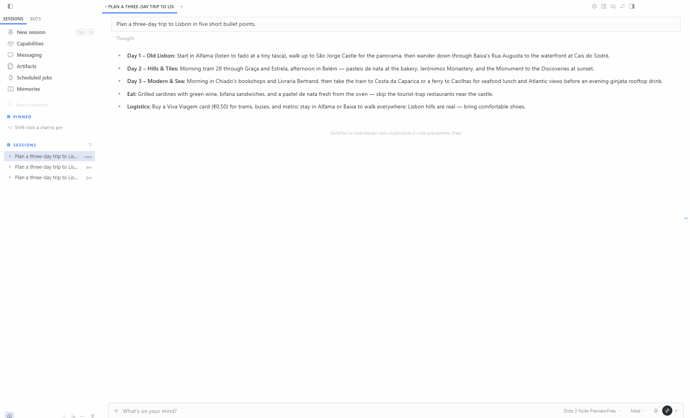
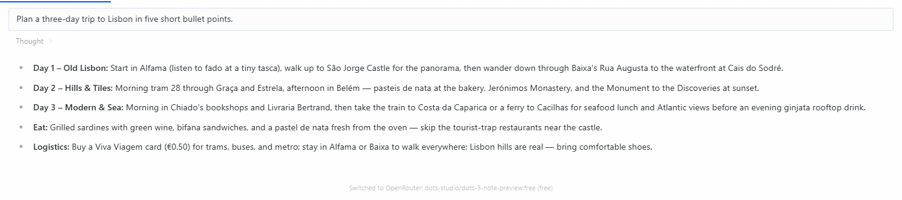
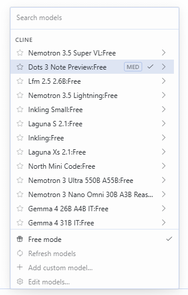
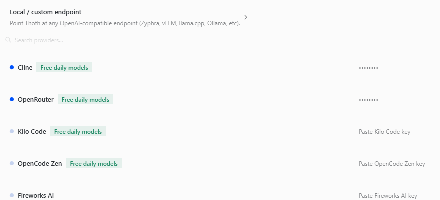
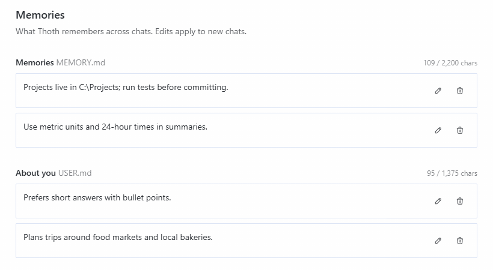

<p align="center">
  
</p>

<h1 align="center">Thoth</h1>

<p align="center"><b>A personal AI agent for Windows that keeps working on free models.</b><br>
Built by <a href="https://github.com/NiceName570"><b>NiceName570</b></a>.</p>

<p align="center">
  <a href="https://github.com/NiceName570/thoth-/releases/latest"></a>
</p>

<p align="center">
  <a href="CHANGELOG.md">Changelog</a> · <a href="LICENSE">MIT License</a> · <a href="https://github.com/NiceName570/thoth-/issues">Report a problem</a>
</p>

<p align="center"></p>

Download the installer, open Thoth, add a free key from Cline, OpenRouter or Kilo Code, and start
chatting. When a free model hits its daily limit, Thoth moves the conversation to the next free
model by itself, so you can keep going without paying.

The installer isn't code-signed yet, so Windows may show a SmartScreen prompt: choose
**More info**, then **Run anyway**.

*Thoth is built on [Hermes Agent](https://github.com/NousResearch/hermes-agent) and is now going its own way.*

## What Thoth does

### Free-model rotation

Free models are generous but small: each one has a daily cap, and they run out mid-task. Thoth
watches for that. When the model you're on runs out or gets rate-limited, Thoth switches to that
provider's next free model and carries on with the same conversation. When a provider's free
models are all used up, it moves to the next provider that has free models, in the order they
appear on the Providers page. A short line in the chat tells you what happened:

<p align="center"></p>

Rotation also covers paid models: if your account runs out of credits mid-task, Thoth finishes
the job on free models instead of stopping.

### Free mode

One switch in the model menu, off by default. Turn it on and Thoth uses only free models: the
chat moves to a free model straight away, the menu lists only free models, and rotation never
falls back to a paid one. Turn it off and you're back on the model you had before.

<p align="center"></p>

### Providers with free daily models, first

Cline, Nous, OpenRouter, Kilo Code and OpenCode Zen all give some models away every day. They
carry a **Free daily models** badge and sit at the top of the Providers page. Thoth keeps their
free-model lists up to date by itself, once a day. If an account has no credits, the model menu
shows only its free models; if a provider can't report credits, you see everything, with the
free models marked. Each provider's "Get a key" link opens that provider's API key page.

<p align="center"></p>

### More providers

Cline (ClinePass and pay-as-you-go), Kilo Code, OpenCode Zen, abliteration.ai, TypeSafe and
DefAPI sit alongside OpenRouter, Anthropic, OpenAI, Gemini, xAI, DeepSeek and the rest. Ollama,
LM Studio and any other OpenAI-compatible server go under **Settings > Providers > Custom
Endpoints**, and their Context field sets the context window, with Auto using the model's own.

### Usage meters

The status bar shows how much of your plan is left on Claude, Codex and OpenRouter, with the reset
time on hover, so a limit never takes you by surprise.

### Memory you can see and edit

Thoth remembers things across chats. The Memories page shows exactly what it has saved, and you
can edit or delete any entry.

<p align="center"></p>

### Jev observer

An optional plugin that scores every reply in the background: did the model understand you,
take your correction on board, or repeat the mistake you just pointed out? Its scores work the
same whatever provider or model you're on, so you can compare them on equal terms, and it never
changes the conversation. [Guide with examples](plugins/jev-observer/README.md).

## Frictions removed

| | |
|---|---|
| **No terminal needed** | One installer `.exe` with Python and everything else inside. It installs to Program Files with a Start menu shortcut and an uninstaller. |
| **No failed updates** | Thoth has its own app ID and update feed, so it only ever installs releases from this repository. |
| **No forced backend** | Nous is one provider among many. You connect the providers you want, one way, and there's no hosted backend in between to break. |
| **No forced downloads** | No llama.cpp download and no model recommendations that never run fast. Local models are optional, through Custom Endpoints. |
| **No setup screen** | No install wizard and no terminal steps: open Thoth, paste a provider key, and chat. |

## Where your data lives

Chats, memories, keys and settings stay on your PC:

- `%LOCALAPPDATA%\hermes`: conversations, memories, API keys (`.env`) and `config.yaml`
- `%APPDATA%\Thoth`: window and app preferences

Uninstalling Thoth leaves both folders in place, so reinstalling picks up where you left off.

## For developers

```
apps/desktop/   The Thoth desktop app (Electron)
agent/          The agent turn loop, providers, memory, fallback and free-model rotation
hermes_cli/     Settings, providers, free-model lists, and the desktop app's backend routes
gateway/        The messaging gateway (Telegram, Discord, Slack and more)
tools/          Tools the agent can use (terminal, files, browser, voice, ...)
plugins/        Bundled plugins, including jev-observer and the model providers
tests/          The Python test suite
```

To build the Windows installer yourself, see [apps/desktop/BUILDING.md](apps/desktop/BUILDING.md).
Development setup and tests are in [CONTRIBUTING.md](CONTRIBUTING.md).

## License

MIT. See [LICENSE](LICENSE).
